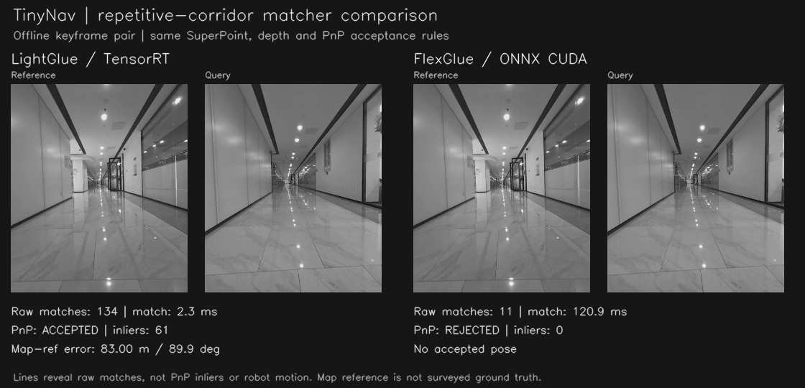
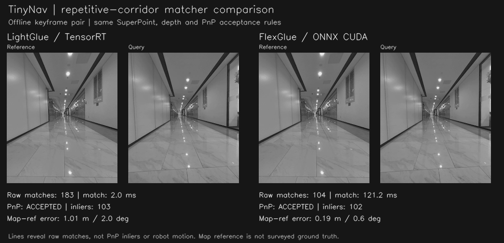
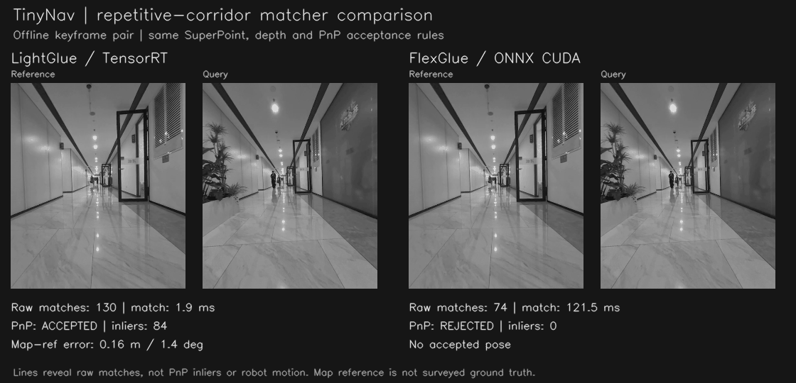

# Optional FlexGlue matching

TinyNav can use the official FlexGlue v0.1 sparse ONNX matcher in place of
LightGlue for map building and map relocalization. LightGlue remains the default;
real-time VIO in `perception_node` continues to use LightGlue.

SuperPoint keypoints, DINOv2/VLAD retrieval, depth filtering, PnP acceptance and
candidate ranking keep their existing behavior. The optional backend returns
matches in the original SuperPoint indexing and pixel-coordinate convention.

## Enable

Inside the usual TinyNav ROS/CUDA environment:

```bash
uv sync --extra flexglue
python -m tool.download_flexglue

python -m tinynav.core.build_map_node \
  --bag_file /path/to/bag --map_save_path /path/to/new_map \
  --feature_matcher flexglue

python -m tinynav.core.map_node \
  --tinynav_map_path /path/to/map --feature_matcher flexglue
```

Omit `--feature_matcher` or select `lightglue` for the existing implementation.
Python callers can pass `feature_matcher="flexglue"` to either node constructor.

The downloader verifies both official models by SHA256 and installs them under
`tinynav/models/flexglue/` (about 439 MiB). Downloads are explicit, not performed
while a node starts. For another directory, use `--model_dir` when downloading
and set `TINYNAV_FLEXGLUE_MODEL_DIR` when running.

A CUDA-enabled ONNX Runtime and its matching CUDA/cuDNN libraries are required.
The tested environment uses ONNX Runtime GPU 1.23.2 and cuDNN 9.10.2.21. Jetson
requires a JetPack-compatible ONNX Runtime CUDA build; a desktop PyPI wheel is
not a Jetson deployment. The backend fails if CUDA cannot initialize instead of
silently using a CPU-only session. It does not load the experimental TensorRT
conversion from our separate performance investigation.

## Maps and storage

Existing maps remain usable: FlexGlue reads their saved infrared images on demand
and keeps a 16-image dense-descriptor LRU (about 64 MiB). It does not rewrite their
feature stores. New keyframes built with FlexGlue include `flexglue_v0_1` in the
existing feature dictionary, with the dense descriptor and original image size.
This costs approximately 4 MiB per keyframe and permits matching while scratch
videos are still being written. Their SuperPoint features remain available, so
these maps can also be used with LightGlue. No pose, depth or ROS schema changes.

## Offline corridor experiment

64 localization requests from front-camera maps 3-10: 32 requests against an
overlapping map and 32 against maps selected using distant similar frames.
Each matcher uses the same target-map VLAD Top-3 candidates and existing
`rerank_by_pnp_inliers` acceptance rules. The target map's vocabulary is used to
encode the query VLAD from stored patch tokens.

| Matcher | Consistent with map reference | Inconsistent accepted | Not accepted |
|---|---:|---:|---:|
| LightGlue TensorRT | 31 | 24 | 9 |
| FlexGlue ONNX CUDA | 31 | 2 | 31 |

Consistency means position error below 0.75 m and full rotation error below
10 degrees against the saved query keyframe pose, transformed to the common map
frame. This is map-derived reference, not surveyed ground truth. The query's
saved pose is used only for evaluation, not to solve its PnP pose. Two originally
correct LightGlue requests are rejected by FlexGlue, while two other requests
change from inconsistent to consistent. Equal totals do not mean identical cases.

On the shared RTX 3070 Laptop GPU, median match-only latency was 3.3 ms for the
existing TensorRT LightGlue and 122.3 ms for official FlexGlue ONNX CUDA. Summed
Top-3 pipeline costs were 41.6 ms and 433.5 ms. Reference descriptors were cached;
FlexGlue includes one query DINOv3 description in the summed cost. The latter
excludes live DINOv2 image encoding, video decoding, ROS and planning. Individual
GIF labels show timings for that illustrated pair, not the dataset median.

These correlated, deliberately challenging samples do not estimate a normal
operating error rate. No continuous ROS mission, rear-camera or Orin validation
is claimed. This PR does not change online localization acceptance thresholds.

## GIFs and reproduction

Each animation progressively reveals raw matches for a fixed pair; it is not
live navigation or robot motion. Lines are not PnP-inlier labels. Each folder
includes a PNG poster and JSON measurements alongside the GIF.

### Similar corridor, wrong place rejected



### Both pass PnP, different pose errors



### A valid localization missed by FlexGlue



Generate these materials read-only from your own saved maps:

```bash
python -m tool.benchmark.compare_matchers \
  --maps_root /path/to/maps \
  --reference 9/929497470776 --query 3/228997459025 \
  --transforms /path/to/optimization.json \
  --output /tmp/corridor-comparison
```

`--transforms` accepts an `optimized_transforms` object or a map-name-to-4x4-matrix
JSON object. It puts both maps into a common coordinate frame for PnP and error
measurement. Omit it for same-map tests; cross-map pose errors are unavailable
without a shared frame. The tool opens feature/depth shelves and videos read-only,
clears the LightGlue inference result cache, warms both matchers and measures
seven actual calls per pair. Query and reference images retain their own sizes.

## Suggested X copy

> Repetitive corridors can fool visual localization. We added an opt-in FlexGlue
> ONNX matcher to TinyNav. In 64 offline corridor requests, accepted map-reference
> mismatches fell from 24 to 2 under the same depth/PnP rules. Higher compute cost;
> Jetson validation next.

The GIFs, posters and draft copy are materials for review, not a published post.

## Upstream models

[FlexGlue](https://github.com/cvg/FlexGlue) is MIT-licensed. Its descriptor includes
DINOv3 weights subject to the separate
[DINOv3 license](https://github.com/cvg/FlexGlue/blob/main/DINOv3_LICENSE.md).
Models are downloaded directly from the official v0.1 release; they are not
repackaged in this repository. The optional runtime requires no PyTorch install.
