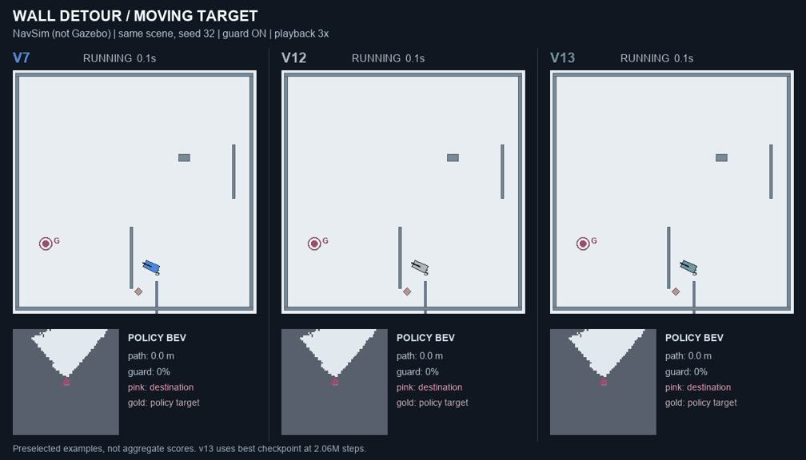
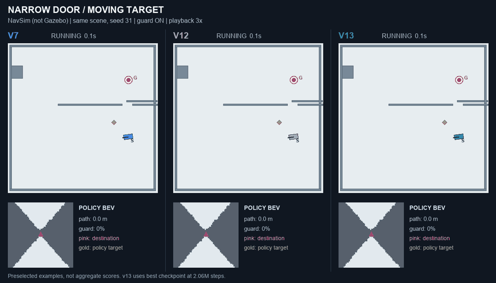

# BEV 到速度指令：训练方法与 v7 / v12 / v13 对比报告

日期：2026-11-07。分支：`xiaole/rl-nav`。代码与结果以本分支为准。

本报告记录网络结构、仿真、PPO、v13 的实际训练过程和本次同条件比较。
v13 发布为实验候选，不替换默认 v7。这里的统计和录像来自自研 NavSim，
不属于 Gazebo 导航验收或真机验收。Gazebo 在 Spark 上已单独跑通 Go2、
双目、IMU、时钟和短距离行走，但尚未用这三个模型进行导航对比。

## 1. 输入、输出与运行链路

```text
双目深度 + VIO 位姿
  -> 100 x 100 x 40、0.1m 分辨率的滚动占据栅格
  -> 机器人坐标系 BEV [3,64,64]，覆盖 6.4m x 6.4m
  -> CNN + 6维状态 -> MLP -> GRU -> actor MLP
  -> 归一化动作 [a_v,a_w] -> [v,w] -> 安全保护器 -> cmd_vel
```

这不是“只有一张 BEV 就独立决定速度”的网络：它还需要导航目标、测量速度、
上次动作和循环记忆。BEV 中机器人控制中心在图像中心，朝向为上，列零在左侧。

| 输入 | 形状 / 内容 | 处理方式 |
|---|---|---|
| `bev` | `[1,3,64,64]` float32 | 高度、已知区域、自身轨迹 |
| 高度通道 | 相对机器人附近地面的最高占据高度 | 地面取附近 0.3–1.5m 命中的较低中位数；截断到 -0.5–1.0m，平地和无命中为零 |
| 已知通道 | 是否观察过这一列 | 区分“自由空间”和“未知空间” |
| 轨迹通道 | 最近 400 tick 的自身路径，约 60s | 越新越亮，并膨胀一格 |
| `vec` | `[1,6]` float32 | `[目标前向/5, 目标左向/5, v/1.0, w/0.75, 上次a_v, 上次a_w]` |
| `h` | `[1,256]` float32 | GRU 隐状态；输出 `h_out` 回送下一帧，新目标或重置时清零 |

输出 `action` 为 `[1,2]`，部署时将 actor 均值裁剪到 `[-1,1]`，没有额外 tanh：

```text
v = a_v * 1.0    (a_v >= 0)
v = a_v * 0.3    (a_v < 0)
w = a_w * 0.75
```

因此训练速度范围为 `[-0.3,1.0] m/s`，角速度为 `[-0.75,0.75] rad/s`。
模型输出后仍需安全保护器、速度/加速度约束、暂停和过期命令检查。

## 2. CNN、MLP、GRU 和训练专用 critic

v7、v12、v13 使用同一网络结构；v13 的变化在训练目标分布，不是增大网络。

| 模块 | 结构 | 输出 |
|---|---|---|
| CNN 1 | Conv2d 3→32，kernel=5，stride=2，ELU，无 padding | 32×30×30 |
| CNN 2 | Conv2d 32→64，kernel=3，stride=2，ELU | 64×14×14 |
| CNN 3 | Conv2d 64→64，kernel=3，stride=2，ELU | 64×6×6 |
| Flatten | 展开 | 2304 |
| 融合 MLP | 拼接 6维 vec，Linear 2310→256，ELU | 256 |
| 循环记忆 | GRUCell，input=256，hidden=256 | h=256 |
| actor MLP | Linear 256→256，ELU，Linear 256→2 | 两个动作均值 |
| critic MLP | 拼接 9维特权状态，Linear 265→256，ELU，Linear 256→1 | 状态价值 V |

CNN 提取局部可通行几何，融合 MLP 加入目标和运动状态，GRU 保留绕障方向、
短时感知和历史决策信息，actor 将记忆转换为速度动作。

critic 仅在训练时使用：9维额外信息是当前到最终目标的测地距离，以及机器人
周围 8 个方向、0.4m 处的距离坡度。它们来自仿真真值，帮助评估绕障进展，
不作为 actor 的额外输入，也不导出到部署 ONNX。

## 3. 仿真数据如何产生

没有预先准备一个“BEV→cmd 标签库”作为 PPO 的主要训练集。策略在 GPU 上并行
与仿真交互，采集状态、动作、奖励和终止信息，再用 PPO 更新。

NavSim 使用平地、随机箱体/长墙、墙阻挡/U 形陷阱、0.8–1.2m 窄门和走廊。
深度不是直接将真值障碍投影成干净 BEV：它解析渲染实际规划器采样的深度像素
（每 10 个像素采样），经过 torch 版本的 raycast、占据融合、滚动/衰减和
同样的 BEV 构造。视角、相机高度/前向偏置/俯仰、深度丢失与噪声均有随机化。
一半回合启用后相机，覆盖前视和前后双视配置。

机器人采用 unicycle 动力学，`dt=0.15s`，最大 400 步（60s）；具有 1步延迟、
线加速度 1m/s²、角加速度 2rad/s² 和约 10% 执行噪声。
碰撞矩形在仿真和运行时一致：前/后各 0.5m，半宽 0.25m，即 1.0×0.5m。

保护器默认在训练循环中启用。它预测约 1s 的运动，要求轮廓离障碍表面至少
0.10m；策略命令不可行时尝试转向、爬行、倒退或停车。已贴墙时允许不进一步
恶化距离的脱困动作。仿真保护器使用真值几何，实机保护器使用 ESDF，因此不能
把仿真中低碰撞率直接解释为感知误差下的真机安全性。

## 4. 奖励与惩罚

下表为本轮 v13 所使用的配置。距离进展指到**最终目标**的测地距离进展，
而不是到不断移动的局部目标的距离，避免目标前移造成伪奖励。

| 项目 | 代码中的计算 / 系数 | 意图 |
|---|---|---|
| 新最佳进展 | `max(历史最小测地距离 - 当前测地距离, 0)` | 奖励真正更接近终点；退出死胡同时不反向扣这一项 |
| 新区域探索 | 每个新 0.5m 网格 +0.05 | 鼓励脱困探索 |
| 时间惩罚 | 每步 -0.01 | 避免长期停住 |
| 动作变化 | `-0.01 * sum((action-last_action)^2)` | 抑制跳变 |
| 近障惩罚 | `-0.15 * clip((0.25-clearance)/0.25,0,1)` | 在轮廓外 0.25m 内逐渐增加惩罚 |
| 转向惩罚 | `-0.1 * (w/0.75)^2` | 抑制蛇形和过度转动 |
| 倒退惩罚 | 最大每步 -0.05；有后相机时乘 0.3 | 减少盲倒退 |
| 保护器拒绝惩罚 | 本轮系数为 0 | 早期实验过度处罚会导致冻结，因此关闭此额外惩罚 |
| 到达奖励 | `+10 + 5*效率`；终点距离 <0.3m | 既到达，也尽量少绕路 |
| 碰撞惩罚 | -10 并结束回合 | 避免碰撞 |
| 路径效率 | `clip((起点测地距离-0.3)/累计行程,0,1)` | 到达附加奖励及评估指标 |

有安全保护器仍可能碰撞，例如带惯性、加速度限制和延迟的实际执行与保护器
预测不完全一致。本次评估也确实出现过少量碰撞，并非严格零碰撞系统。

## 5. Recurrent PPO 怎么更新

1. 每个环境采样连续 64步，保留开头的 GRU 状态；每个 done 后清零该环境记忆。
2. 训练 actor 使用两个独立 Normal 分布，标准差是可学习参数，初始继承检查点。
   采样动作后由仿真裁剪执行；部署改用确定性的均值并裁剪。
3. 用 `gamma=0.995`、`lambda=0.95` 计算 GAE 和价值目标，并标准化优势。
4. 按环境划分 minibatch，保证 64步循环序列完整；每次更新进行 4轮优化。
5. PPO ratio=`exp(logπ_new-logπ_old)`，clip=0.2，策略目标采用 clipped surrogate。
6. `vf=0.5*mean((V-return)^2)`；总损失=`策略损失 + 0.5*vf - 0.002*熵`。
   优化器为 Adam，梯度范数裁剪到 1.0。

超时与碰撞/到达不同，代码会做超时价值补偿。不过当前实现使用的是步进前的
`V(s_t)`，而不是超时终止观测的 `V(s_{t+1})`；这是现有实现的近似和后续应检查
的地方，本轮没有改动这一语义。PPO 的循环反向传播跨度为 64步，而非整段回合。

一般训练用五级课程逐步增加目标距离、障碍密度、陷阱大小和 U形比例，缩小门宽；
最近十次更新总体成功率≥80%、碰撞≤10%、门场景到达率≥60%，且冷却≥20次更新后升级。
v13 从最高 level 4 开始，不重新经过简单课程。

可选的人类演示来自实机 bag，重建同样 BEV，姿态差分标注 `(v,w)`，并取前方
约 2.2m 的回溯目标。BC 只保留安全且移动帧，窄段加权，序列前16帧只热身。
v12 的训练历史包含演示；v13 不传 `--demos`，所以本轮 BC 损失为零，但继承的
v12 权重仍保留先前训练影响，不能将它理解为从未学过人类演示。

## 6. v7、v12、v13 的来源与本轮实际运行

| 版本 | 检查点步数（该阶段） | 训练差异 |
|---|---:|---|
| v7 | 22,953,984 | 在共享 1.0×0.5m 轮廓上训练；此前 corridor 集成验证最好，保留为默认 |
| v12 | 18,038,784 | 在此前 v11 基础上，保护器进入训练循环；包含窄门课程、演示和后相机训练历史 |
| v13 best | 2,056,192 | 从 v12 best 微调；加入 2.2m 移动局部目标；不加 BC 损失；小学习率 |
| v13 last | 9,338,880 | 后期持续退化后提前停止，不作为部署文件来源 |

这些步数是各自检查点记录的训练阶段步数，不是从最初版本起累计的总样本数。
v13 将 actor 的目标改为沿测地路由约 2.2m 前方的点，机器人移动后重新计算。
最终目标、测地进展、到达判定保持不变。该路由来自模拟全局规划，不是网络
自己预测的路径；相当于实际 `map_node` 提供局部 carrot 的上游角色。
这是对真实全局路径目标的近似，不能保证与现场 `map_node` 的路径形状完全相同。

```bash
python -m tinynav.rl.train_ppo \
  --run tinynav_db/rl_runs/ppo_v13_carrot \
  --init tinynav_db/rl_runs/ppo_v12_guarded/best.pt \
  --steps 20000000 --carrot-distance 2.2 --level 4 \
  --envs 128 --horizon 64 --epochs 4 --minibatch 2048 \
  --lr 5e-5 --lr-end 5e-6 --eval-every 25 --seed 0
```

每次更新采集 8,192 个 transition。学习率按原计划 20M 步线性下降；提前停止
意味着没有退火到 5e-6。每25次更新在固定 seed 999、256回合上评估，按照
`成功率 - 0.5*near_miss率` 保存 best.pt，而不是使用最后权重。

Spark 上 11:14 开始，约16:04提前停止。最佳模型选在206万步；其选择集成功率
92.2%、碰撞0%。到922万步时成功率84.4%、碰撞0.8%，因此没有继续耗尽20M预算。
这说明后期策略质量退化；不能仅凭它确定是 PPO、奖励、目标或数据分布中哪一项
单独导致。训练代码和网络结构的其他改动尚需受控消融才能定位原因。

## 7. 本次同条件统计比较

| 目标模式 | 模型 | 成功率 | 碰撞率 | 超时率 | 门场景到达率 | 路径效率 | near-miss |
|---|---|---:|---:|---:|---:|---:|---:|
| 固定终点 | v7 | 86.13% | 0.00% | 13.87% | 70.71% | 74.66% | 1.76% |
| 固定终点 | v12 | 89.65% | 0.20% | 10.16% | 74.46% | 78.99% | 2.35% |
| 固定终点 | v13 best | 87.30% | 0.00% | 12.70% | 77.39% | 79.37% | 3.91% |
| 2.2m移动目标 | v7 | 86.91% | 0.20% | 12.89% | 73.80% | 84.13% | 6.26% |
| 2.2m移动目标 | v12 | 89.45% | 0.00% | 10.55% | 82.23% | 85.84% | 4.30% |
| 2.2m移动目标 | v13 best | 92.19% | 0.00% | 7.81% | 86.90% | 85.46% | 2.73% |

结论：移动目标下，v13 相比 v12 的总体成功率提高 **2.73 个百分点**，
门场景到达率种子均值提高约 **4.67 个百分点**，near-miss 降低约 **1.56 个百分点**。
但固定目标下，v13 成功率 87.30%，低于 v12 的89.65%。移动目标下 v13 的
成功回合效率85.46%，也未超过 v12 的85.84%；尚未直接量化总体平均速度。
因此证据支持“v13 是更值得继续验证的移动目标候选”，不支持“各方面全面更好”。
这次 v12 的绝对数值与此前文档历史表不完全相同，因为本次统一采用当前分支的
仿真器、回合数、种子和场景混合；跨时期表格不应直接作严格配对比较。

方法：三个 best.pt，最高课程 level 4，每种目标模式分别使用 seed 2024、2025，
每个种子256回合，合计每行512回合、全表3,072回合。陷阱概率0.3，非陷阱场景
窄门概率0.35，保护器启用。每种模型/目标模式使用同一场景生成种子；由于回合
结束后自动 reset 消耗随机数，后续噪声序列不保证逐帧完全配对。原始逐种子
结果保存在 [comparison.json](rl_v13/comparison.json)。

表中各指标均为两个种子各自统计值的算术平均；每行回合数相同，所以总体成功、
碰撞、超时率也等于512回合合并值。陷阱/门场景数与成功子集数不同，对应条件
指标的“种子均值”不等于严格按子集样本数加权的合并率。原始 JSON 可复核。

“门场景成功率”只表示这个场景中到达终点，不保证真正从门洞通过。near-miss
定义为未碰撞回合中轮廓最小间距<0.1m；效率只统计成功回合。
只有两个测试种子，模型选择还使用了另一个固定 seed 999，不能把百分点差异
直接解释为具有统计显著性的泛化提升。

## 8. 典型并排录像：本次新录制

每个案例三个模型的地图、出生点、初始朝向、终点完全一致，录制脚本进行数组
相等断言；单环境使用相同随机种子。种子31/32/33在录制前指定，未按赢家筛选。
v13 使用206万步最佳权重。视频3倍速，提前到达的模型定格，时间为仿真时间。
画面包括世界轨迹、1.0×0.5m轮廓、BEV、当前目标和累计保护器介入比例。

| 案例 | v7 | v12 | v13 best | 观察 |
|---|---:|---:|---:|---|
| [窄门，固定目标](rl_v13/door_fixed.mp4) | 24.15s | 22.50s | 28.95s | v13 更慢；三个模型均绕墙端，没有直接穿门 |
| [同一窄门，移动目标](rl_v13/door_moving.mp4) | 25.95s | 23.70s | 20.55s | v13 更快，但依然绕墙，不能据此声称学会过门 |
| [绕墙，移动目标](rl_v13/wall_moving.mp4) | 37.05s | 12.30s | 16.20s | v12 最快；v7 保护器约45%，v12 0%，v13约2% |
| [密集障碍，移动目标](rl_v13/clutter_moving.mp4) | 8.10s | 28.50s | 7.35s | v13更直接；v12路径约10.8m，v13约6.6m |

这四例全部到达，没有用成功案例去替代失败率统计。它们展示具体行为差异，
不代表随机总体排序。所有原始案例指标见 [examples.json](rl_v13/examples.json)。





## 9. 其他测试机如何使用本次 ONNX

发布文件：`tinynav/models/rl_nav_policy_v13.onnx`。来自 v13 best.pt，
不是 last.pt。v7/v12 ONNX 同目录保留，默认模型仍是 v7。

```bash
# 宿主机的 tinynav 项目中；本地有改动先保留，不要强制 reset
git fetch origin
git switch xiaole/rl-nav
git pull --ff-only origin xiaole/rl-nav
git lfs pull --include='tinynav/models/rl_nav_policy_v*.onnx'

# 以下在对应机器的 tinynav-dev 容器内执行
cd /tinynav/tinynav/models
make rl_nav RL_NAV_ONNX=rl_nav_policy_v13.onnx
export TINYNAV_PLANNER=rl
export TINYNAV_RL_ENGINE="/tinynav/tinynav/models/rl_nav_policy_v13_$(uname -m).plan"
# 用项目现有启动入口启动应用，并让 planning_node 和 cmd_vel_control 都继承这两个变量
```

若本地尚无该分支，使用 `git switch --track origin/xiaole/rl-nav` 创建。
TensorRT plan 应在目标机器上构建，不能仅按 aarch64/x86_64 名称跨不同 GPU、
TensorRT 版本复用。Makefile 使用 FP32；本次网络较小，不主动切换 FP16 GRU。
切回 v7 时，构建 v7 plan 并把 `TINYNAV_RL_ENGINE` 指回 v7；删除该变量也使用
默认 v7 路径。取消 `TINYNAV_PLANNER=rl` 则回到原轨迹库规划。

ONNX 为静态 batch=1、opset17；输入名 `bev,vec,h`，输出名 `action,h_out`。
模型不包含深度重建、占据图、局部目标生成、速度缩放和安全保护器；使用项目
现有 `RLPlanner` 集成，而不是直接把原始 action 当成 ROS Twist。

导出验证：ONNX checker 通过；ONNX Runtime CPU 与 PyTorch 对照4条各128步的循环序列，
分别独立回送各自 h。输入采用本次录像的真实 BEV 和 [-1,1] 范围合成状态向量，
共512步；动作最大绝对误差 `1.55e-06`，隐状态最大绝对误差
`6.34e-06`，均小于2e-5，输出有限且动作在[-1,1]内。
核对了全部输入输出名称和形状，ONNX 不含 critic 权重。
部署路径参数量 **1,110,530**，文件大小 **4,446,276 bytes**。
本验证是数值等价检查，不是目标机 TensorRT 或闭环导航验收。

ONNX SHA-256：`ba0419bdfc8ee0da558fe44de3acc692238c529c9eb267b7ef7501f65c2e6dca`。
验证脚本：[validate_onnx.py](rl_v13/validate_onnx.py)。
完整版本、来源检查点摘要与验证结果见 [model_manifest.json](rl_v13/model_manifest.json)。

## 10. 复现文件与后续验证

- `tinynav/rl/policy.py`：CNN/MLP/GRU 和 actor/critic。
- `tinynav/rl/sim.py`：感知仿真、动力学、奖励、保护器和移动目标。
- `tinynav/rl/train_ppo.py`：PPO、课程、可选 BC、配置记录、最佳模型选择。
- `tinynav/rl/eval_policy.py`：同条件评估，可指定 `--carrot-distance`。
- `tests/test_rl_carrot.py`、`tests/test_rl_planner.py`：目标语义和运行时保护测试。
- [compare.py](rl_v13/compare.py)、[record.py](rl_v13/record.py)：本次统计与案例录制脚本。
- [训练评估历史](rl_v13/training_evaluations.json)：本轮固定选择集的全部评估点。
- [训练配置](rl_v13/train_config.json)、[模型来源](rl_v13/model_manifest.json)：实际参数、权重步数和文件摘要。

后续优先验证：目标机模型加载/闭环推理，Gazebo 相同路线多次运行，实机窄门的
直接通过比例、目标跟随误差、耗时/路长、保护器介入率。未完成这些验证前，
不把某个 NavSim 成功率或单个漂亮录像作为替换默认模型的依据。
