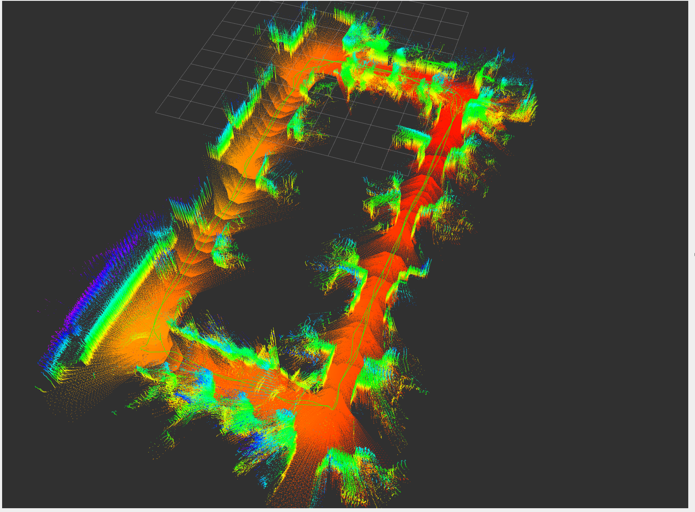

# Scripts Reference

This document provides an overview of the key scripts in the `scripts/` directory and how to use them for different TinyNav workflows.

# Development Inside Container

| Script                        | Description                                                                                   |
|-------------------------------|----------------------------------------------------------------------------------------------|
| `run_planning.sh`             | Runs the planning node for collision-free path generation (default planning mode).            |
| `run_navigation.sh`           | Runs the full navigation pipeline using a pre-built map for localization and planning.        |
| `run_rosbag_examples.sh`      | Runs a demo pipeline: launches core nodes, plays a sample rosbag, and opens RViz for visualization. |
| `run_rosbag_build_map.sh`     | Builds a map from a specified rosbag file, launching all required nodes and RViz.            |
| `run_realsense_sensor.sh`     | Starts the RealSense camera ROS 2 driver on your host system.                                |
| `run_sensors_preview.sh`      | Starts the RealSense sensor driver and opens `rqt` after a short delay for live preview.     |
| `run_rosbag_record.sh`        | Records the mapping rosbag topics into the XDG data directory.                               |
| `run_map_record.sh`           | Launches RealSense in tmux, waits 3s, then calls the rosbag record helper.                   |
| `record_nav_comparison.sh`    | Records DWA/PPO navigation, camera images, and active runtime configuration for comparison. |

## DWA and PPO comparison

Set the planner in the deployment container before starting the app.

```bash
export TINYNAV_PLANNER=dwa
bash scripts/start_app.sh
```

For the PPO run, start the app with `TINYNAV_PLANNER=ppo`. Restart the app,
planning node, and velocity controller when switching. An export in a new
terminal applies to processes subsequently started from that environment.
The launcher passes the selected configuration to its tmux session.

Both planners default to processing the latest synchronized depth/pose
pair and omitting the diagnostic occupied-voxel point clouds. Set
`TINYNAV_PLANNING_LATEST_PAIR_ONLY=0` or
`TINYNAV_PLANNING_DIAGNOSTIC_CLOUDS=1` before startup to override these
defaults. `TINYNAV_PLANNING_TIMING=1` enables the timing topic for either
planner. The comparison recording includes the obstacle mask, height
map, and footprint.

`dwa` selects the existing trajectory-library baseline. `ppo` selects the
PPO model with route guidance and loads
`tinynav/models/rl_nav_policy_ppo_20261114.plan`. Build that engine on the
device as described in [the PPO deployment guide](../docs/rl_navigation_ppo_20261114.md).
`TINYNAV_RL_ENGINE` can select an explicitly built engine. The legacy
`library` and `rl` values also work.

Use the same map, POIs, robot configuration, target lookahead, and measured
start pose for both runs. The deployed 3 m local-target change can be used
for both planners. The recorder saves the active map-node source so its
lookahead implementation is available during analysis. The manifest
records each planner's geometry and collision settings.

With sensors and navigation nodes running, begin a recording before sending the POI.

```bash
bash scripts/record_nav_comparison.sh --label poi5-r1
```

Wait for rosbag2 to report `Recording...`. Run the route, wait three
seconds after arrival or stopping, and press Ctrl+C. Repeat from the
same start pose for each planner, using labels such as `poi5-r2`.

The script reads the running planning and control processes to label the
bag. It saves `runtime-config.json` with the Git commit when Git metadata
is accessible, selected engine path and SHA-256, PPO footprint and center,
robot profile, and controller
constants. The corresponding source files are saved under `sources/`.
The recording is under `bag/` and includes the obstacle mask, height map,
global route, local target, poses, both velocity-command topics, timing,
navigation state, logs, and one front camera topic.

Camera selection prefers compressed color images, followed by available
raw color or infrared images. Supply `--image-topic /your/front/image`
to choose a specific `Image` or `CompressedImage` publisher.
Use `--no-video` for a data-only recording. Add
`--depth` to record `/slam/depth` for perception replay.

File-level zstd compression runs when rosbag2 closes each database.
After Ctrl+C, wait for the script's final saved message. The complete
output directory defaults to
`${TINYNAV_RECORD_DIR:-$HOME/.local/share/tinynav/rosbags}`. Upload that
directory, including the manifest and source files. Use `--output-root`
to save recordings under `/tinynav_data`.

```bash
bash scripts/record_nav_comparison.sh --label poi5-r1 --output-root /tinynav_data
```

TinyNav supports several key modes to fit different robotics workflows:

1. **Planning Only**
   - In this mode, TinyNav generates collision-free paths while the robot is teleoperated (e.g., using a joystick or keyboard), as illustrated with the [LeKiwi mobile robot](https://huggingface.co/docs/lerobot/lekiwi).
   - To start planning-only mode, simply run:
     ```bash
     bash scripts/run_planning.sh
     ```

2. **Mapping Only**
   - Use this mode to build a map of a specific environment.
   - **Step 1: Record data from the RealSense camera**
     - On the machine connected to the RealSense camera, launch the combined recording workflow:
       ```bash
       bash scripts/run_map_record.sh
       ```
     - This script starts the RealSense driver in tmux, waits 3 seconds, then calls `run_rosbag_record.sh` to record the camera and IMU data into a rosbag.
     - Recorded bags are saved under `${XDG_DATA_HOME:-$HOME/.local/share}/tinynav/rosbags/` for later mapping.
   - **Step 2: Build the map from the recorded data**
     - Use the recorded rosbag to build a map:
       ```bash
       bash scripts/run_rosbag_build_map.sh
       ```
     - All generated maps will be saved in the `tinynav_map` directory.

   - You can also build a map using the included example data:
      ```bash
      bash scripts/run_rosbag_build_map.sh
      ```
    <picture>
      
    </picture>

3. **Map-Based Navigation**
   - Navigate your robot using a pre-built map created with the mapping workflow above.
   - In the map-based GUI, you can set up paths or points of interest (POIs) for the robot to follow.
   - To launch map-based navigation, run:
     ```bash
     bash scripts/run_navigation.sh
     ```
   - The robot will follow the designated POIs in the order you specify.
